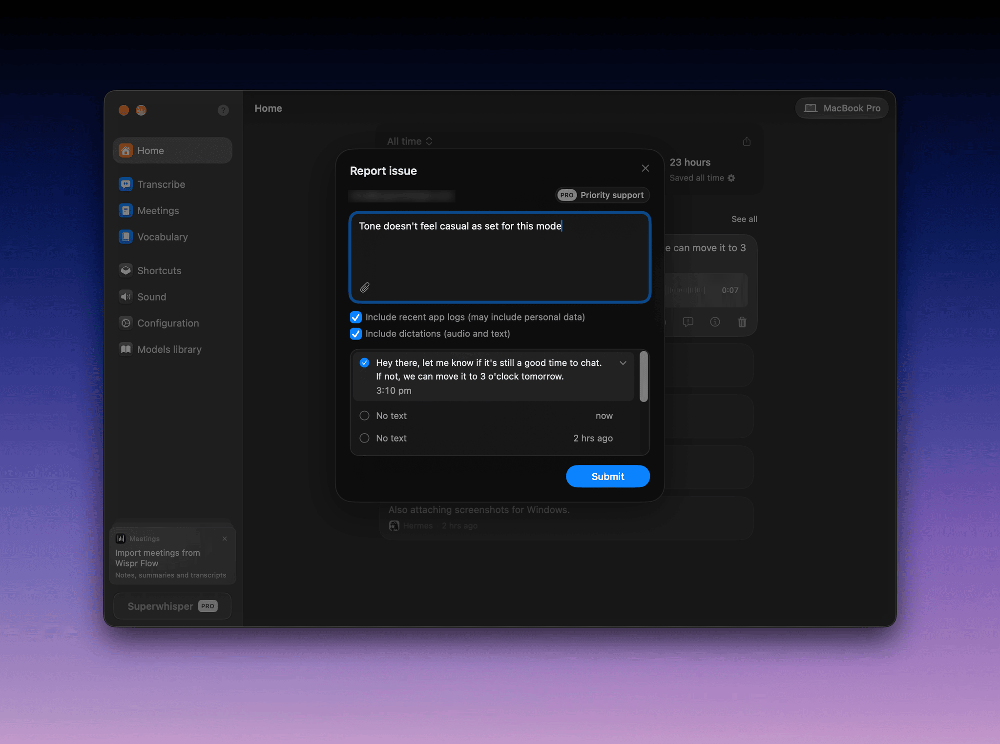

<Note>
This page applies to Superwhisper on macOS. On iOS, see [Report an issue](/get-started/history#report-an-issue).
</Note>

When a dictation comes out wrong, send it to us from inside the app. The report can include the audio, the text, and recent app logs. That gives us what we need to find the cause.

## Open the report form

Use any of these:

- **From a recording (best):** on **Home** or in History, find the dictation that went wrong. Click the speech bubble icon with an exclamation mark. That dictation is selected for you.
- **From the right-click menu:** right-click a recording and choose **Report issue…**.
- **From the sidebar:** click the **?** button at the top of the sidebar, then **Report issue**.

<Frame>
  
</Frame>

## Fill in the form

<Steps>
  <Step title="Describe the problem">
    Type what happened and what you expected. For example: "Tone doesn't feel casual as set for this mode." Name the mode and the app you were dictating into. The form needs a message before you can send it.
  </Step>
  <Step title="Check your email">
    We reply to the email shown under the title. With a license, the app fills it in. Without one, type the address you want us to use.
  </Step>
  <Step title="Choose what to include">
    - **Include recent app logs** adds the last 30 minutes of Superwhisper's logs. The logs may include personal data.
    - **Include dictations (audio and text)** attaches the dictations you pick from the list. The list shows your 8 most recent dictations. Pick only the ones that show the problem. If a dictation is too large to attach, the form leaves it unselected.
  </Step>
  <Step title="Attach files if needed">
    Click the paperclip to add files, or paste a screenshot with **⌘ V**. You can attach up to 5 files. Each file must be 10 MB or smaller.
  </Step>
  <Step title="Send">
    Click **Submit**, or press **⌘ Return**. The button shows **Sent** and the form closes.
  </Step>
</Steps>

<Frame>
  
</Frame>

<Warning>
Audio, transcripts, and logs can contain private information. Include only what shows the problem, and leave out dictations you don't want us to read. See [Sensitive data best practices](/security/sensitive-data).
</Warning>

## Get the most from a report

1. Turn on **Error logging** in **Settings → Configuration** before you reproduce the problem. See [Logs, clean uninstall, and reporting bugs](/common-issues/diagnostics).
2. Reproduce the problem once, then send the report right away. Logs cover only the last 30 minutes.
3. Send the dictation that failed, not only the message. We can then replay it with the same mode and models.
4. Say which app version you run and which models the mode uses.

## If you can't send the form

Email [support@superwhisper.com](mailto:support@superwhisper.com) instead. Say what happened and how to reproduce it. Attach a screenshot of the mode's settings. To attach a recording, open it in History, click the **info** icon, then **Open file location**, compress the folder, and attach it.

## Related

- [History](/get-started/history): review and reprocess past dictations
- [Logs, clean uninstall, and reporting bugs](/common-issues/diagnostics)
- [Troubleshooting](/common-issues/troubleshooting)
