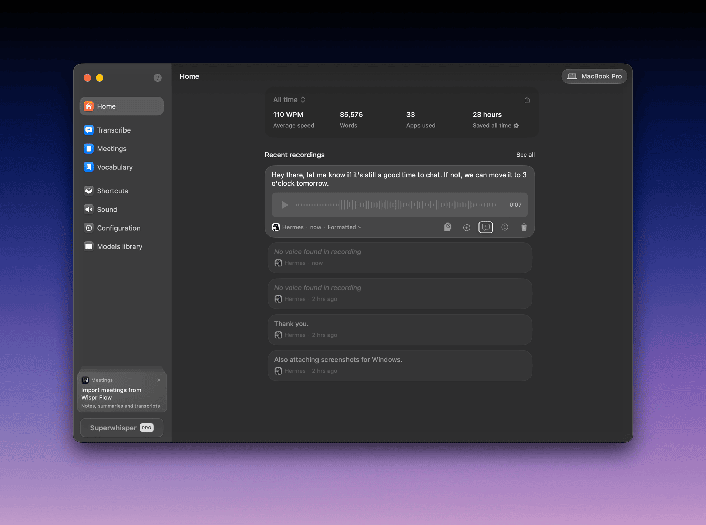

When a dictation comes out wrong, send it to us from inside the app. The report can include the audio, the text, and recent app logs. That gives us what we need to find the cause.

<Tabs>
  <Tab title="macOS">
    ### Open the report form

    Use any of these:

    - **From a recording (best):** on **Home** or in History, find the dictation that went wrong. Click the speech bubble icon with an exclamation mark. That dictation is selected for you.
    - **From the right-click menu:** right-click a recording and choose **Report issue…**.
    - **From a recording's details:** open the recording, then click **Report issue** at the bottom, next to **Open file location**.
    - **From a meeting:** open the meeting and click **Report issue** at the bottom, next to **Open file location**. The meeting is selected for you.
    - **From the help menu:** click the **?** button next to the window buttons at the top left, then **Report issue**.

    <Frame>
      
    </Frame>

    ### Fill in the form

    <Steps>
      <Step title="Describe the problem">
        Type what happened and what you expected. Name the mode and the app you were dictating into. The form needs a message before you can send it.
      </Step>
      <Step title="Check your email">
        We reply to the email shown under the title. With a license, the app fills it in. Without one, type the address you want us to use.
      </Step>
      <Step title="Choose what to include">
        - **Include recent app logs** adds the last 30 minutes of logs. They may include personal data.
        - **Include dictations (audio and text)** attaches the dictations and meetings you pick from your 8 most recent. Pick only the ones that show the problem. One that is too large to attach stays unselected.
      </Step>
      <Step title="Attach files if needed">
        Click the paperclip, drag files in, or paste a screenshot with **⌘ V**. You can attach up to 5 files of 10 MB or less.
      </Step>
      <Step title="Send">
        **Submit** turns blue once you type a message. Click it, or press **⌘ Return**. The button shows **Sent**.
      </Step>
    </Steps>

    <Frame>
      
    </Frame>
  </Tab>
  <Tab title="Windows">
    ### Open the report form

    Use either of these:

    - **From a recording (best):** open **History**, open the recording's **info** details, and click **Report Issue**. That dictation is selected for you.
    - **From the help menu:** click the **?** button in the title bar, next to **Home**, then **Report issue**.

    ### Fill in the form

    <Steps>
      <Step title="Describe the problem">
        Type what happened and what you expected. Name the mode and the app you were dictating into. The form needs a message before you can send it.
      </Step>
      <Step title="Check your email">
        We reply to the email shown under the title. With a license, the app fills it in. Without one, type the address you want us to use.
      </Step>
      <Step title="Choose what to include">
        - **Include recent app logs** adds recent logs. They may include personal data.
        - **Include dictations (audio and text)** attaches the dictations you tick from your 8 most recent. Turn it on to see the list. Tick only the ones that show the problem. A dictation that is too large to attach can't be ticked.
      </Step>
      <Step title="Attach files if needed">
        Click the paperclip, drag files onto the window, or paste a screenshot. You can attach up to 5 files of 10 MB or less.
      </Step>
      <Step title="Send">
        **Submit** turns blue once you type a message. Click it, or press **Ctrl Enter**. The button shows **Sent**.
      </Step>
    </Steps>
  </Tab>
  <Tab title="iOS">
    The iOS app has no Error logging setting. The report sends the recording and its details.

    <Steps>
      <Step title="Open the recording">
        Swipe up to open History, then tap the recording that went wrong.
      </Step>
      <Step title="Choose Report issue">
        Tap the **…** menu at the top, then **Report issue**. In older versions, tap the **i** icon, then **Report issue**.
      </Step>
      <Step title="Describe the problem">
        Check your email, which the app fills in from your license. Type what went wrong, then tap **Upload**.
      </Step>
    </Steps>
  </Tab>
  <Tab title="Android">
    The Android app has no Error logging setting. The report sends the recording and its details.

    <Steps>
      <Step title="Open the recording">
        Swipe up on the home screen to see your recordings, then tap the one that went wrong.
      </Step>
      <Step title="Open its info">
        Tap the **Recording info** icon, then **Report Issue**.
      </Step>
      <Step title="Describe the problem">
        Type what went wrong, then tap **Upload**.
      </Step>
    </Steps>

    For general feedback, tap **Settings → Share Feedback**. If we ask for your debug ID, open **Settings → Configuration** and tap the version number at the bottom. Tap the ID to copy it.
  </Tab>
</Tabs>

<Warning>
Audio, transcripts, and logs can contain private information. Include only what shows the problem, and leave out dictations you don't want us to read. See [Sensitive data best practices](/security/sensitive-data).
</Warning>

## Get the most from a report

1. On Mac and Windows, turn on **Error logging** in **Settings → Configuration** before you reproduce the problem. See [Logs, clean uninstall, and reporting bugs](/common-issues/diagnostics).
2. Reproduce the problem once, then send the report right away. On Mac, logs cover only the last 30 minutes.
3. Send the dictation that failed, not only the message. We can then replay it with the same mode and models.
4. Say which app version you run and which models the mode uses.

## If you can't send the form

Email [support@superwhisper.com](mailto:support@superwhisper.com). Say what happened and how to reproduce it. Attach a screenshot of the mode's settings. On Mac or Windows, you can also attach the recording: open it in History, click the **info** icon, then **Open file location**, compress the folder, and attach it.

## Related

- [History](/get-started/history): review and reprocess past dictations
- [Logs, clean uninstall, and reporting bugs](/common-issues/diagnostics)
- [Troubleshooting](/common-issues/troubleshooting)
