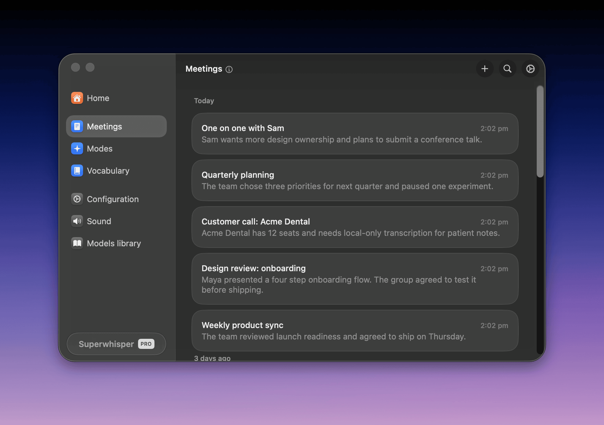
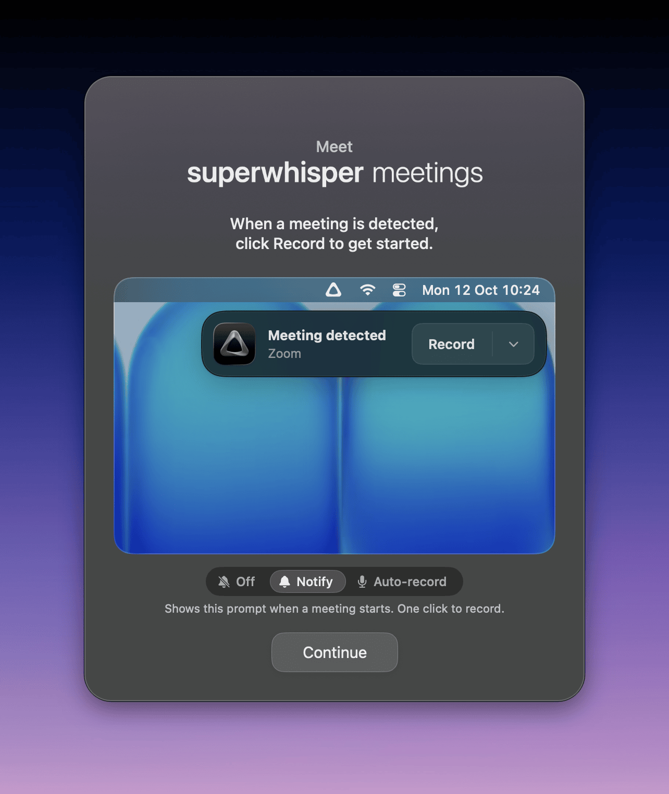
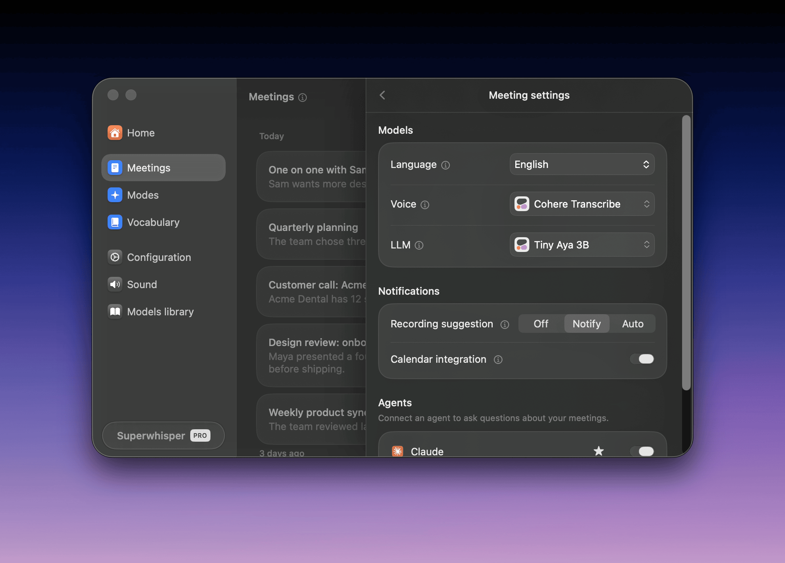

Meetings records your microphone and your Mac's audio, shows a live transcript with a label for each speaker, and writes a summary when the call ends. No bot joins the call.

<Frame>
  
</Frame>

<Note>
Meetings needs macOS and Superwhisper 3.0 or later. It's a **Pro** feature. On the Free plan, it uses your free trial words. See [Plans](#plans). On an Enterprise license, your admin can [turn Meetings off](/enterprise/configuration#how-policies-affect-meetings).
</Note>

Meetings live in their own **Meetings** tab. They don't appear in [History](/get-started/history) or count in your dictation stats.

## Permissions

- **Microphone**: records your voice
- **Screen & System Audio Recording**: records the other side of the call. Turn it on in **System Settings → Privacy & Security → Screen & System Audio Recording** (**Screen Recording** on macOS 14)
- **Calendars** (optional): only for [calendar integration](#calendar-integration)

## Set up

The first time you open the **Meetings** tab, a short tour asks how Superwhisper should offer to record. To replay it, click the **i** next to the **Meetings** title.

<Frame>
  
</Frame>

If the tab shows **Set up meetings**, click it and choose your models.

### Meeting settings

Click the gear on the **Meetings** tab. These settings apply to meetings only, not to your dictation modes.

<Frame>
  
</Frame>

- **Language**: pins the transcription language. **Auto** works for most meetings
- **Voice**: the voice model that writes the transcript
- **LLM**: the language model that writes the summary
- **Recording suggestion**: see [Meeting detection](#meeting-detection)
- **Calendar integration**: see [Calendar integration](#calendar-integration)
- **Agents**: see [Ask an agent](/meetings/share#ask-an-agent-about-your-meetings)

### Choose models

- **Voice**: the list starts with the best models for meetings. Cohere Transcribe is the most accurate local model. S1-Voice is the cloud default. Parakeet, Scribe, and Nova 3 follow
- **LLM**: S1-Language is the cloud default. For local summaries, choose **Tiny Aya 3B** or **Qwen 3.5 2B**. S1-mini can't write summaries

Voice models that can stream do so automatically. Meetings has no **Realtime** switch.

Speaker separation always runs on your Mac. Its model (about 150 MB) downloads before your first meeting.

To keep everything on your Mac, see [Private and offline meetings](/meetings/offline).

## Meeting detection

Set **Recording suggestion** in **Meeting settings**:

- **Off**: no prompts. Start each recording from the **Meetings** tab
- **Notify**: a **Meeting detected** prompt appears when a call starts. Click **Record**
- **Auto**: recording starts by itself

Either way, Superwhisper asks before it stops a recording.

{/* IMAGE: images/screens/mac/meeting-detected-prompt.png | The Meeting detected prompt with the Record button */}

Detection works with **Zoom**, **Google Meet**, **Microsoft Teams**, and **Slack** huddles, in the desktop app or the browser. It also detects **FaceTime** calls. For other apps, [start the recording yourself](/meetings/record#start-a-recording).

## Calendar integration

Connect a calendar in **Meeting settings** to get a reminder about a minute before each meeting. Turn on either source, or both:

- **Apple Calendar** reads the calendar in the macOS Calendar app. It covers every account you added there, including Google, Microsoft 365, and iCloud
- **Google Calendar** signs in to your Google account and doesn't need the macOS Calendar app

Once a calendar is connected, **Show meetings in menu bar** appears. From 15 minutes before a meeting until it ends, the meeting's name and a countdown show beside the menu bar icon, so you can join and record from the menu.

Each reminder works like this:

- **Join & Record** opens the call link and starts recording. If you already joined, the button reads **Record**
- The event title and attendees fill in the meeting
- All-day, cancelled, and declined events get no reminder, and neither do events with one attendee and no call link

{/* IMAGE: images/screens/mac/meeting-calendar-prompt.png | A calendar reminder that reads Starts in 1 min with the Join & Record button */}

**Apple Calendar:** calendar data stays on your Mac. If the setting shows **Calendar access is off**, turn on Superwhisper in **System Settings → Privacy & Security → Calendars**.

**Google Calendar:** Superwhisper asks Google for read-only access. Your Mac reads your events directly from Google. Our server handles only sign-in and keeps an encrypted token so the app stays connected. Turn off **Google Calendar** to disconnect. That deletes the token from our server and revokes the access at Google. If sign-in fails, the setting shows **Google sign-in didn't complete**. Try again.

## Import meetings from other apps

On Mac 3.3.0 and later, bring meetings over from Granola, Wispr Flow, or Otter. Imported meetings keep their transcript and notes, but not their audio.

1. Click the gear on the **Meetings** tab and find **From other apps**
2. Open the app's row and click the button there to go to its export
3. Export your meetings:
   - **Granola:** **Settings → Profile**, then **Generate CSV**. Granola emails you a download link, which can take a couple of hours
   - **Wispr Flow:** **Settings → Data and Privacy**, then **Request a copy** under **Download your data**. Click **Download** when it's ready
   - **Otter:** open a conversation, click **Export**, and save. On a paid plan, select several on **Home** to export them at once
4. Drop the ZIP onto the **Import meetings** box, or click it to select files

Superwhisper imports only meetings it doesn't have yet.

## Plans

On the Free plan, meetings use the same free trial words as other Pro features. When they run out, the app shows **Meetings require Pro**.

- A meeting in progress stops recording, and Superwhisper keeps the audio
- Past meetings stay readable, marked **Free words used — this meeting is read-only**
- Reading a meeting is always free. Regenerating a summary needs Pro or free words

See [Plans](/billing/plans).

<Info>
On an Enterprise license, your organization's policies decide whether Meetings is available. If **Allow system audio recording** is off, the **Meetings** tab is hidden. See [How policies affect Meetings](/enterprise/configuration#how-policies-affect-meetings).
</Info>

## Next steps

<CardGroup cols={2}>
  <Card title="Record a meeting" icon="record-vinyl" href="/meetings/record">
    Start and end recordings, take notes, and name speakers.
  </Card>
  <Card title="Summaries and templates" icon="file-lines" href="/meetings/summaries">
    Change the summary format or write your own template.
  </Card>
  <Card title="Share and ask an agent" icon="share-nodes" href="/meetings/share">
    Send a summary anywhere, and ask AI about past meetings.
  </Card>
  <Card title="Private and offline meetings" icon="lock" href="/meetings/offline">
    Keep audio, transcripts, and summaries on your Mac.
  </Card>
</CardGroup>
